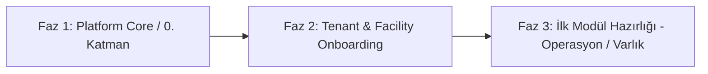

# Medical ISG — Teknik Orkestrasyon ve Başlangıç Yol Haritası (Brainstorming)

Bu doküman, **Medical ISG (Entegre Tesis Yönetim Sistemi - ETYS)** projesinin başlangıç aşaması için mimari stratejiyi, önceliklendirilmiş skill matrisini, 3 fazlı başlangıç planını ve açık kararları kayıt altına alır. Gelecek adımlar için değişmez referans noktasıdır.

---

## 1. Bu Aşama İçin Seçilen Skill Listesi (Öncelik Sırasıyla)

1. **`00-workflow-orchestrator`** (`.agents/skills/04-workflow-orchestrator/SKILL.md`)
2. **`20-software-architect`** (`.agents/skills/20-software-architect/SKILL.md`)
3. **`20-multi-tenancy`** (`.agents/skills/24-multi-tenancy/SKILL.md`)
4. **`20-database-architect`** (`.agents/skills/21-database-architect/SKILL.md`)
5. **`20-security-auth`** (`.agents/skills/25-security-auth/SKILL.md`)
6. **`30-design-system`** (`.agents/skills/30-design-system/SKILL.md`)
7. **`40-integration-hub`** (`.agents/skills/45-integration-hub/SKILL.md`)

---

## 2. Skill Seçim Gerekçeleri

| No | Skill | Seçim Gerekçesi |
|---|---|---|
| 1 | **00-workflow-orchestrator** | **Süreç & Kalite Kapısı:** Erken/plansız kod üretimini engellemek, adımları katı fazlara bölmek ve ordu standartlarını baştan yürütmek için yürütme beynidir. |
| 2 | **20-software-architect** | **Monorepo Omurgası:** PNPM workspace, `apps/backend` (NestJS), `apps/web` (Vite) ve `packages/shared` (@isg/shared) arasındaki bağımlılık ve modül izolasyonu sınırlarını kurmak için esastır. |
| 3 | **20-multi-tenancy** | **Veri İzolasyonu & Hiyerarşi:** İki seviyeli (Grup → Tesis) hiyerarşi ve tenant-per-DB mimarisinde dinamik DB bağlantı havuzu (connection pool) ve routing stratejisini tasarlamak için zorunludur. |
| 4 | **20-database-architect** | **0. Katman Şeması:** Platform çekirdeği (Grup, Tesis, Kullanıcı, Rol, İzin, Lisans/Modül Yetkisi) için Prisma şablon ve meta-DB modellerini oluşturmak için gereklidir. |
| 5 | **20-security-auth** | **Kimlik & Yetkilendirme:** 2FA (TOTP), kısa ömürlü JWT (15 dk), Argon2id, RBAC ve Tesis bazlı ABAC mekanizmasını 0. Katman'da kurmak için kritik güvenlik hattıdır. |
| 6 | **30-design-system** | **Tasarım & UI Sözleşmesi:** Vite + Tailwind + shadcn/ui tabanında `Medical_ISG_Brand_Kit_v2` ve `Design-System.md` token'larını (renk, tipografi, radius) koda bağlamak için gereklidir. |
| 7 | **40-integration-hub** | **Sistem Tetikleyicileri:** 0. Katman'daki Telegram Bot ve SMTP (e-posta) servislerinin BullMQ asenkron kuyruk yapısıyla mimariye oturtulması için lazımdır. |

---

## 3. 3 Fazlı Başlangıç Yol Haritası

### Faz 1: Platform Core (0. Katman)
- **Monorepo & Workspace Altyapısı:** PNPM workspaces, TypeScript strict config, ESLint/Prettier, `packages/shared` DTO/Type omurgası.
- **Backend Çekirdek Kurulumu:** NestJS modüler yapısı, Global Exception Filter, Zod Validation Pipe, Yapılandırılmış Logger, Audit Interceptor.
- **Veritabanı Motoru:** Merkezi Platform DB (Tenant/Grup/Tesis metadata, Lisanslar) + Kiracı Şablon Veritabanı (Template DB) Prisma şemalarının oluşturulması.
- **Kimlik & Güvenlik:** JWT + Refresh Token, Argon2id şifreleme, 2FA TOTP akışı, RBAC guard ve tenant header/subdomain çözümleme middleware'i.
- **Kuyruk & Depolama Hazırlığı:** Redis + BullMQ bağlantısı, MinIO S3 presigned URL altyapı modülü.
- **Web Kabuğu:** Vite + React + TS, Design System token'ları (`brand-tokens.css`), Tailwind ve shadcn/ui tabanı, Auth Layout (Giriş, 2FA, Şifre Sıfırlama).

### Faz 2: Tenant/Facility Onboarding Akışı
- **Grup & Tesis Yaşam Döngüsü:**
  - Grup şirketi oluşturma (Ör: *A Grup A.Ş.*).
  - Tesis ekleme (Ör: *A Tesisi - Merkez Kampüs*).
- **Otomatik DB Provisioning (Kiracı İmalatı):**
  - Yeni kiracı açıldığında template DB'den yeni PostgreSQL veritabanının klonlanması/migration'ların uygulanması.
  - Tesis için varsayılan rollerin, kategorilerin ve departmanların seed edilmesi.
- **Modül Lisanslama & Erişim Matrisi:**
  - Tesise özel modül aktivasyonu (Operasyon, İSG, Sağlık, Varlık, Taşeron, Atık).
  - İlgili modüllerin UI menü ve API guard düzeyinde aktif/pasif kontrolü.
- **Yönetici Davet & Atama Akışı:**
  - Tesis Yöneticisi ve İSG Müdürü davet mailleri, ilk şifre belirleme ve 2FA aktivasyonu.
- **Entegrasyon Ayarları:**
  - Tesise özel Telegram Bot webhook/chat_id bağlantısı ve SMTP relay yapılandırması.

### Faz 3: İlk Modül İçin Hazırlık (Kapsam Belirleme)
*Öneri:* İlk iş modülü olarak **Operasyon Yönetimi** (veya temel bağımlılık olan **Varlık Envanteri**) seçilmelidir.
- **Kapsam:**
  - Arıza/talep bildirim yaşam döngüsü (Açık → İnceleniyor → Aksiyonda → Onay Bekliyor → Kapatıldı).
  - Fotoğraflı kanıt yükleme (MinIO presigned upload + Sharp WebP/thumbnail sıkıştırma).
  - Görev atama ve SLA/termin takibi.
  - Telegram ve E-posta olay bildirimlerinin (Event-driven / BullMQ) tetiklenmesi.
  - Tesis bazlı audit log ve filtreleme.

---

## 4. Açık Kararlar & Önerilen Çözümler

Aşağıdaki kararlar Faz 1 implementasyonuna geçmeden önce orkestrasyon tarafından netleştirilmiştir:

1. **Çoklu Kiracı DB Yönetim Modeli (Routing & Migration):**
   - **Karar/Öneri:** Çift Veritabanı Modeli.
     - `Platform DB` (Merkezi PostgreSQL): Kiracılar (Tenants), Tesisler (Facilities), Lisanslar, Global Kullanıcı kimlikleri, Audit logları.
     - `Tenant DB` (Her tesis/kiracı için izole PostgreSQL): İş verileri.
     - **Bağlantı Stratejisi:** Gelen istekte JWT / `x-tenant-id` okunur; NestJS `TenantConnectionService` içindeki LRU Cache tabanlı Prisma Client havuzundan ilgili tenant bağlantısı çözümlenir.
     - **Migration:** `infra/migration-runner` CLI aracı; önce Template DB güncellenir, ardından aktif kiracı DB'lerine sırayla `prisma migrate deploy` koşulur.

2. **Monorepo Paket Yöneticisi:**
   - **Karar/Öneri:** **PNPM Workspaces + Turborepo**.
   - Turborepo; `packages/shared`, `apps/backend` ve `apps/web` arasında pipeline önbellekleme (caching) ve paralel test/build işlemlerini hızlandırır.

3. **İlk Geliştirilecek İş Modülü Önceliği:**
   - **Karar/Öneri:** **Operasyon Yönetimi (Operations)**.
   - PRD §5.1 ve §7.1 ile uyumlu olarak; arıza, görev, vardiya ve mobil entegrasyon için en temel kanıt mekanizmasıdır. 0. Katman tamamlandığında ilk canlıya çıkacak dikey dilimdir.

4. **Docker Geliştirme Ortamı:**
   - **Karar/Öneri:** `infra/docker/docker-compose.dev.yml` ile PostgreSQL, Redis ve MinIO servisleri ayağa kaldırılır. Kod container içinde volume mount ile çalıştırılır (`pnpm dev:backend`, `pnpm dev:web`).

---

## 5. Uygulama İlerlemesi ve Durum Raporu

### ✅ Faz 1.1 — Docker-First Monorepo, Super Admin & Akıllı Giriş Mimarisi (TAMAMLANDI)
- **Problem & Çözüm (Sıfır Tesis Durumu):**
  - Başlangıçta sistemde tesis veya grup bulunmadığında kullanıcıların tıkanmaması için **Platform Sahibi (Super Admin)** mimarisi kuruldu.
  - Karmaşık açılır liste seçimleri kaldırıldı; yerine kullanıcının yalnızca **E-Posta ve Şifre** girdiği **Akıllı Giriş Sistemi** getirildi.
  - Sistem kullanıcının rolünü (Super Admin, Holding Yöneticisi, Tesis Müdürü) ve bağlı olduğu tesisi otomatik olarak tespit edip ilgili yetki alanına yönlendirir.
- **Super Admin Onboarding Konsolu:**
  - Yeni Holding/Grup Şirketi tanımlama ("Yeni Grup Ekle" modalı ile grup adı, vergi no, yönetici e-postası).
  - Gruplar altına doğrudan izole veritabanına bağlanacak Tesisler ekleme ("Bu Gruba Tesis Ekle" modalı ile tesis adı, şehir, tehlike sınıfı).
  - Tesisler için varsayılan izole veri tabanı (`isg_tenant_<facId>`) ve modül lisanslama kontrolleri.
- **Resmi shadcn/ui Preset (`b3ZMTpzVUO`) & Enterprise Design-System.md Standartları:**
  - `Design-System.md` güncel spesifikasyonuna harfiyen uyumlu lüks enterprise SaaS kabuğu uygulandı.
  - **Dot-Grid & Radial Glow:** Arka plana kurumsal hafif radyal degrade (`rgba(15,118,110,0.12)`) ve minimal 24px noktalı kılavuz (dot-grid) deseni entegre edildi.
  - **Palet & Tipografi (HSL Tokens):**
    - Arka plan: `slate-50` (`#f8fafc`), metinler derin `slate-900` (`#0f172a`), yardımcı metinler `slate-500` (`#64748b`).
    - Birincil Kurumsal Sağlık Rengi: `#0f766e` (Teal-700 / Kurumsal Sağlık Zümrütü) ve hover `#115e59` (Teal-800).
  - **Split Hero & Enterprise Kartlar:**
    - Sol kolon: H1 başlık, açıklama ve 3 sütunlu kompakt teknik kartlar (`Tenant-per-DB`, `2FA & RBAC`, `Docker Stack`).
    - Sağ kolon: Yüksek kontrastlı, yumuşak gölgeli ve `backdrop-blur` destekli shadcn kurumsal giriş kartı + tek tıkla dolduran hızlı test hesapları.
  - **Header & Footer:**
    - Header: Medical İSG logo, "İŞ SAĞLIĞI VE GÜVENLİĞİ" üst metni, yanıp sönen yeşil dot ile "0. Katman Platform Çekirdeği" rozeti ve "v4.2-enterprise" etiketi.
    - Footer: © 2026 Medical İSG Yazılım Çözümleri A.Ş., KVKK, SLA ve destek linkleri.
  - Docker Nginx container (`isg_web`, Port 80) üzerinde canlı testler tarayıcı subagent'ı ile uçtan uca doğrulanıp kaydedildi.

---

## 6. Sıradaki Uygulama Adımı: Faz 1.2 — Backend Çekirdek & Tenant Connection Manager

Bir sonraki adımda yapılacak teknik çalışmalar:
- **Aktif Skill'ler:** `20-multi-tenancy` + `20-security-auth` + `40-fullstack-engineer`
- **Görevler:**
  1. `apps/backend` NestJS modül iskeletinin ayağa kaldırılması (`PlatformModule`, `TenantConnectionModule`).
  2. LRU Cache tabanlı Dinamik `TenantConnectionService` (Gelen istekteki `x-tenant-id` veya subdomaine göre template DB'den klonlanan izole DB bağlantısını getiren servis).
  3. Argon2id şifreleme + JWT + 2FA TOTP kimlik doğrulama guard ve controller'larının yazılması.
  4. Platform seed scripti (Varsayılan Super Admin ve Demo Holding/Tesis kaydı).

---

*Not: Bu dosya projenin teknik pusulasıdır. Her faz öncesinde güncellenecektir.*

